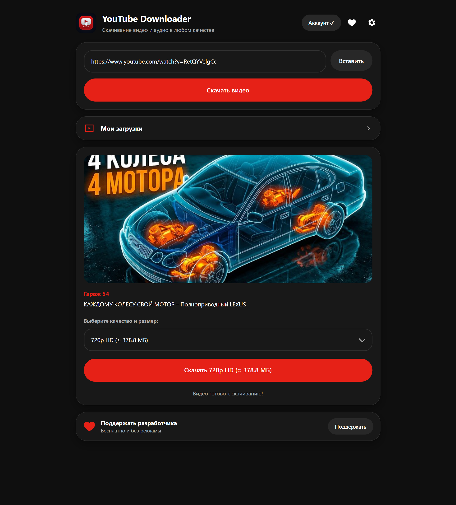
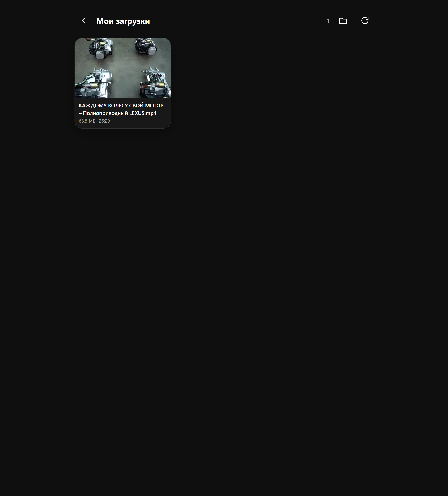
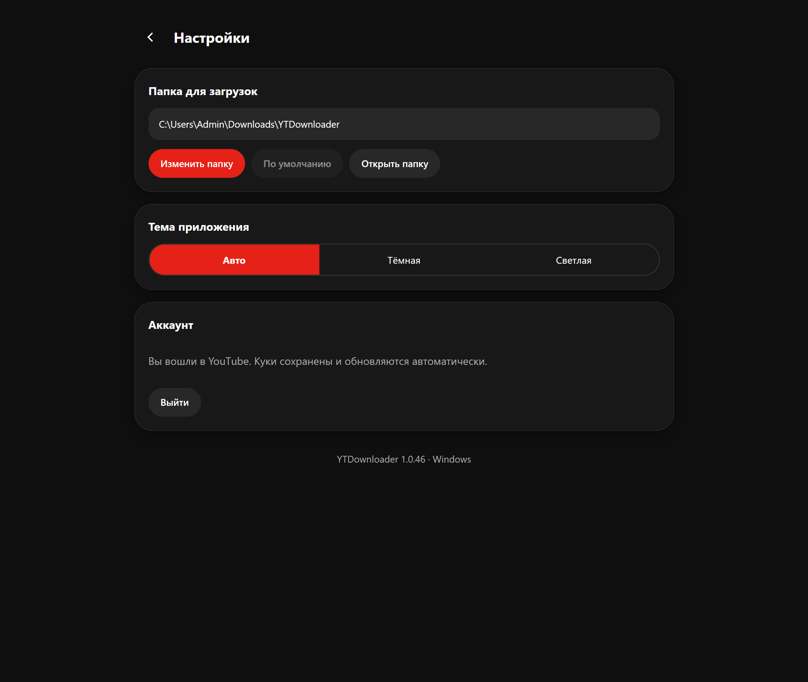

# YouTube Downloader (YTDownloader) — Windows

ПК-версия Android-приложения [YouTube Downloader](https://github.com/Virtualchild01/YouTube-Downloader):
тот же функционал, тот же интерфейс, плюс отдельный экран настроек с выбором папки для загрузок.



## Ключевые возможности

1. **Интеллектуальный выбор качества видео**:
   - В списке отображаются только те разрешения, которые реально доступны для данного видео — для 1080p-ролика пункты 4K и 2K скрываются автоматически.
   - `16K Ultra HD (8640p)` и `8K Ultra HD (4320p)` появляются только если ролик действительно отдаёт такое разрешение.
   - `4K Ultra HD (2160p)`, `2K Quad HD (1440p)`, `1080p Full HD`, `720p HD`, `480p SD`, `360p`.
   - `Аудио (MP3)` — только звуковая дорожка.
   - `AVI для старых ТВ (Xvid)` — перекодировка в Xvid + MP3 для старых телевизоров и DVD-плееров.
   - **HDR**: если у ролика есть HDR-поток в выбранном разрешении, приложение скачивает именно его и помечает пункт надписью `· HDR`. Пометка честная: ролик с HDR только в 1080p покажет «4K» без пометки, потому что в 4K там только SDR.
2. **Предварительный расчёт размера файла**:
   - Размер показывается прямо в списке рядом с каждым качеством: `1080p Full HD (≈ 88.9 МБ)`, `720p HD (≈ 42.1 МБ)`, `MP3 (≈ 4.5 МБ)`.
3. **Интеллектуальное отображение времени скачивания**:
   - Оставшееся время форматируется в секунды (`~45 с`), минуты и секунды (`~8 мин 20 с`) или часы и минуты (`~1 ч 15 мин`).
4. **Эргономичный ввод и предпросмотр**:
   - Кнопка быстрой вставки из буфера обмена («Вставить»).
   - Карточка предпросмотра: обложка ролика, название и автор канала.
   - Поддержка ссылок любого формата: `youtube.com/watch?v=...`, `youtu.be/...`, `youtube.com/shorts/...`.
5. **Авторизация сохраняется между запусками**:
   - Вход через встроенное окно Google, cookies хранятся в формате Netscape и обновляются перед каждой загрузкой.
6. **Галерея «Мои загрузки»**:
   - Превью, размер и длительность, встроенный плеер, удаление и показ файла в папке.
   - Кнопки «Поделиться» здесь нет — на ПК у неё нет смысла, в отличие от Android.

   
7. **Настройки**:
   - Папка для загрузок, тема (Авто / Тёмная / Светлая), аккаунт.
   - Тема и папка запоминаются между запусками.

   

## Скачивание

Установщик лежит в разделе [Releases](https://github.com/Virtualchild01/YTDownloader-Desktop/releases):
`YTDownloader-1.0.46-setup.exe`.

Ставится в `%LOCALAPPDATA%\Programs\YTDownloader` без прав администратора, создаёт ярлыки
в меню «Пуск» и на рабочем столе. Обновление ставится поверх без удаления приложения.

## Сборка

Зависимостей из npm нет: Electron, NSIS, rcedit и `@electron/asar` раскладываются скриптом.

```bash
node scripts/fetch-deps.js      # скачивает бинарники и инструменты сборки
node build/make-installer.js    # собирает dist/YTDownloader-<версия>-setup.exe
```

`fetch-deps.js` кладёт Electron, NSIS, rcedit, `ffmpeg.exe` и `yt-dlp.exe` на свои места
и сверяет каждый файл с закреплённым SHA-256. Версии зафиксированы, поэтому сборка
воспроизводима. Повторный запуск ничего не скачивает заново.

Скрипт не хранит бинарники в репозитории намеренно: `ffmpeg.exe` весит 100.5 МБ,
а GitHub отклоняет файлы больше 100 МБ.

Требования: Windows 10/11 x64, Node.js. Нужны `curl.exe` и `tar.exe` — оба входят в Windows.

## Структура

```
main/
├── main.js            окно, меню, IPC, протокол media://
├── preload.js         мост window.api в renderer
├── paths.js           пути приложения и бинарников
├── settings.js        настройки в settings.json
├── auth.js            cookies Netscape, признаки авторизации
├── ytdlp.js           вызовы yt-dlp, разбор прогресса и ошибок
├── quality.js         варианты качества и выбор формата
├── downloader.js      скачивание, прогресс, конвертация в AVI
├── storage.js         сохранение, галерея, превью
└── formatters.js      размеры, ETA, таймкоды
renderer/              интерфейс (index.html, styles.css, app.js)
resources/             иконки; bin/ с yt-dlp.exe и ffmpeg.exe создаёт fetch-deps.js
scripts/fetch-deps.js  скачивание зависимостей сборки
build/                 make-installer.js, pack-asar.js, installer.nsi
vendor/                Electron, NSIS, rcedit, @electron/asar
```

## Как решается `n challenge` YouTube

YouTube требует решить JS-задачу, иначе отдаёт только раскадровку, а любая загрузка
падает с «Requested format is not available». Своё решение требует JS-рантайма,
а yt-dlp по умолчанию ищет только `deno`, которого у пользователя обычно нет.

Отдельный Node в сборку не кладётся: Electron — это тот же Node, и в режиме
`ELECTRON_RUN_AS_NODE` он исполняет скрипт солвера. Скрипт берётся из самого yt-dlp
(пакет `yt_dlp_ejs`), поэтому сеть для него не нужна. Подробности — в `main/ytdlp.js`.

## Отличия от Android-версии

| | Android | Windows |
|---|---|---|
| Куда сохраняется | Movies/YTDownloader и Music/YTDownloader | папка из настроек (по умолчанию `Загрузки\YTDownloader`) |
| Смена папки | нет | экран настроек, шестерёнка в шапке |
| «Поделиться» в галерее | есть | нет |
| Прогресс в фоне | foreground-сервис и уведомление | окно и статус на экране |
| Поворот в плеере | ориентация экрана | разворот видео на 90° |
| Обновление движка | встроено в APK | yt-dlp обновляется сам раз в сутки |

## Лицензия

MIT
